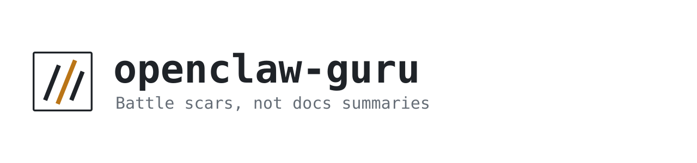

**The product is one file.** Install it and you get `open-claw-guru.agent.md` — operational
OpenClaw knowledge, nothing else. Everything else in this repo is scaffolding that keeps that
file honest: freshness CI, the gated window-bump script, copy-sync checks, brand assets.
Contribute knowledge to the file, discipline to the scaffolding — they never mix (enforced by CI).

  

An OpenClaw expert you can install — a **subagent** for Claude Code, Cursor 2.4+, GitHub
Copilot, and Gemini CLI, or an **OpenClaw-native skill** your gateway bots can load — with
**operational depth** on [OpenClaw](https://openclaw.ai). Not a docs summary. The knowledge
inside comes from running a multi-agent OpenClaw fleet in production through major version
migrations, state-schema changes, memory incidents, and outages. Where the docs say "it
should work," this agent knows what actually breaks.

## Install

**Marketplace (recommended):**
```
/plugin marketplace add JordanNewell/openclaw-guru
/plugin install openclaw-guru@openclaw-guru
```

**Raw file:**
```
mkdir -p ~/.claude/agents
curl -fsSL https://raw.githubusercontent.com/JordanNewell/openclaw-guru/main/agents/open-claw-guru.agent.md \
  -o ~/.claude/agents/open-claw-guru.agent.md
```

Marketplace install keeps the agent under the plugin cache (namespaced, updated by
version bumps); raw copy puts it in your personal agents dir (updated by re-running
the curl). Both work; they don't collide.

**Harness compatibility** (the file is standard Claude Code frontmatter with a
Copilot-friendly `.agent.md` extension):

| Harness | Status |
|---|---|
| Claude Code | Native — all documented frontmatter fields used |
| Cursor 2.4+ | Native — reads `.claude/agents/*.md` (`color` ignored) |
| GitHub Copilot | Loads (`.agent.md` is Copilot's convention) |
| Gemini CLI | Copy to `.gemini/agents/` — same markdown+YAML shape |
| Codex / opencode | Needs conversion (TOML / own format) — not provided yet |

Then ask Claude Code anything OpenClaw — gateway troubleshooting, fleet upgrades,
channel config, skills mechanics, cron — and it can delegate to the guru. Because
subagents have shell access, the guru can run `openclaw doctor`, `openclaw skills check`,
and log greps on your machine directly — applying its protocol to real output.

## Running an OpenClaw gateway instead? (skill variant)

The same knowledge ships as an **OpenClaw-native skill** — `openclaw-guru-skill/SKILL.md` —
so your gateway bots can answer OpenClaw operations questions with the same depth. Load it
like any workspace skill: copy the `openclaw-guru-skill/` directory into the bot's
`workspace/skills/` (or your fleet's skill-install flow).

The skill body is the agent file's knowledge **verbatim** — one source of truth, three
packages (agent file, marketplace plugin, skill). CI enforces the sync; every re-verified
window lands in all three at once.

## Who this is for

| If you are… | Start here |
|---|---|
| Running 3+ agents in production | The whole file is your manual. Read the fleet-lessons and doctor sections first |
| Running your first bot | Skip this for now — start with `openclaw configure` and the official docs. Come back when you run multiple agents |
| Debugging something on fire | Troubleshooting Playbook + Known Gotchas sections |
| Sponsoring/maintaining OpenClaw | The `openclaw doctor` side-by-side protocol — community-artifact teaching of what official docs can't say bluntly |

## Why this one is different

Every version claim has a **shelf life**, and this repo treats that as a feature:

- **[CHANGELOG.md](CHANGELOG.md)** — what release the knowledge was last verified against
- **freshness-watch CI** — weekly check; if npm's latest OpenClaw exceeds the verified
  window, an issue opens automatically. Stale knowledge never hides.
- **[VERIFICATION.md](VERIFICATION.md)** — every knowledge section mapped to its source,
  split into DOC-VERIFIED vs OPERATOR-OBSERVED claims
- **[INCIDENTS.md](INCIDENTS.md)** — anonymized production war stories: the D-state
  memory wedge, the doctor hang, the 429 storm, the mixed-version outage
- **Honest limits** — the file itself carries a "When NOT to Trust This Agent" section

Numeric defaults are approximations (sampled from docs + production, verified window
noted in the CHANGELOG) — the agent verifies before asserting, and you should too.

## Contributing

Your battle scars are the most valuable contribution — see
[CONTRIBUTING.md](CONTRIBUTING.md) and the **Gotcha report** issue template. Evidence-backed
gotchas upgrade claims from OPERATOR-OBSERVED to DOC-VERIFIED.

**Languages:** the knowledge is written in English, but the guru answers in whatever
language you're conversing in — no translation needed to use it. README translations are
welcome (mark them "community translation — English is canonical"); the knowledge files
themselves stay English-only so every re-verification updates one source of truth.

## License

[MIT](LICENSE). Not affiliated with or endorsed by the OpenClaw project or the OpenClaw
Foundation.
